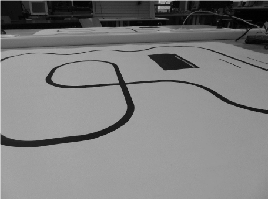

# LineFollower

## Specifications:

Microcontrollers: Arduino Nano (ATmega328P) + ESP32-C3 Super Mini

Motors: 2× Pololu 15:1 Micro Metal Gearmotor HPCB, 12 V, met magnetische encoders

H-bridge: DRV8833 Dual H-Bridge Motor Driver

Sensors: HY-S301, 8-channel analog IR reflectance sensor array

Battery: Tattu 2S LiPo, 7.4 V, 550 mAh, 95C

Wireless communication: Wi-Fi 2.4 GHz / Bluetooth LE via ESP32-C3

Distance sensor - Motors: 70mm

Weight:

Speed: 

